# The touch screen

The unit's own screen as it is built: a 2.8-inch ILI9341 display (320 x 240 in landscape, SPI) with an XPT2046 resistive touch panel. Wiring: [HARDWARE.md](HARDWARE.md#touch-screen). Shell commands: [CONTROL.md](CONTROL.md). Last checked against the code: 15 Nov 2026.

**15 Nov 2026: a screen for the backing track, and a fifth button on the home screen's bottom line, were flashed at the author's word; later the same day the track list learned folders and a search** (the author's tracks are in folders below `/TRACKS`, and there will be thousands). Both run on the unit and were gone through with injected taps; the author has not yet said how they look and feel on the glass.

**State on 14 Nov 2026: the display is wired and running.** The author wired it and reported it works; the unit finds it at boot, touch was calibrated on the glass, and presets were changed from it. The screens are also checked by host tests and as pictures, and on the unit by taps sent over the shell (`tft tap`). The first noise reading is under "What it costs"; what the author has not yet said is under "What is not checked".

## What it shows

| Home | Home with everything at work |
| --- | --- |
| 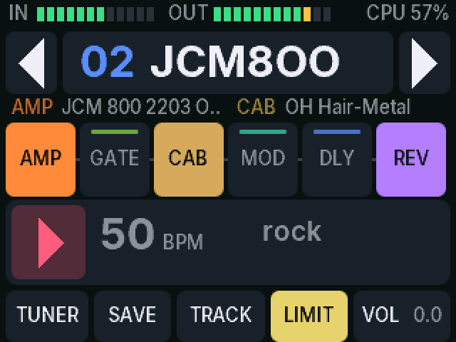 | 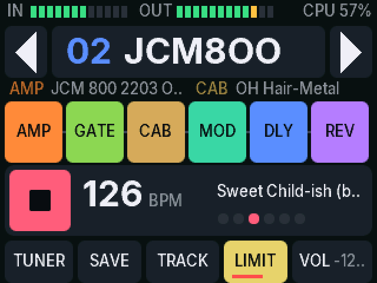 |
| Home, the preset edited | Preset list |
| 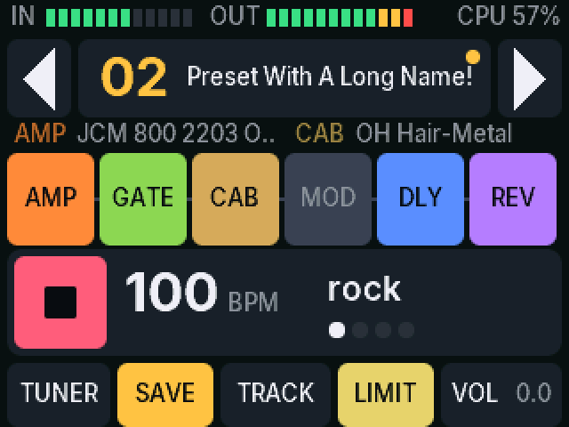 | 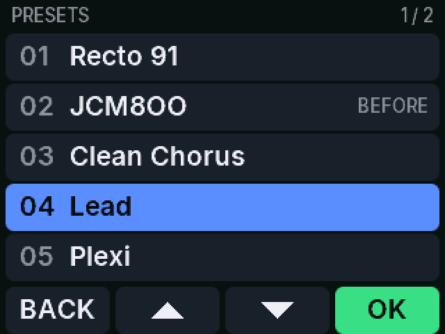 |
| A block's settings | Tuner |
| 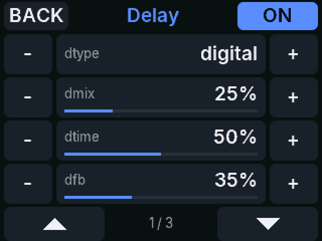 | 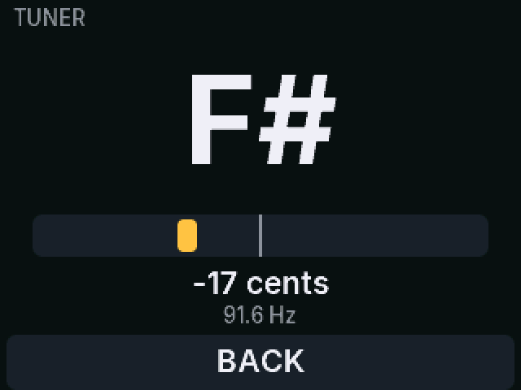 |

| The amp's settings, its model first | The list of models |
| --- | --- |
| 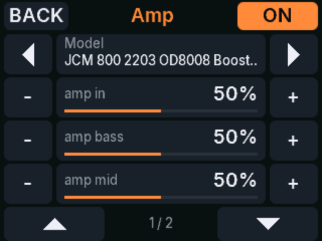 | 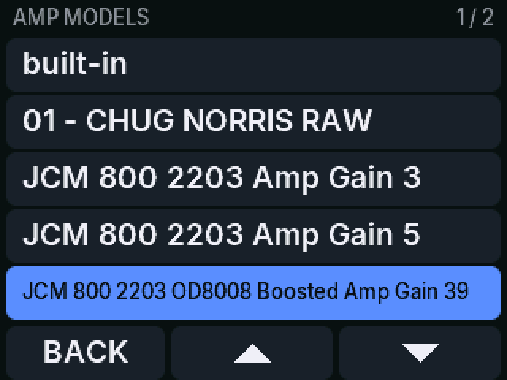 |

| Home while the trainer runs | The speed trainer |
| --- | --- |
| 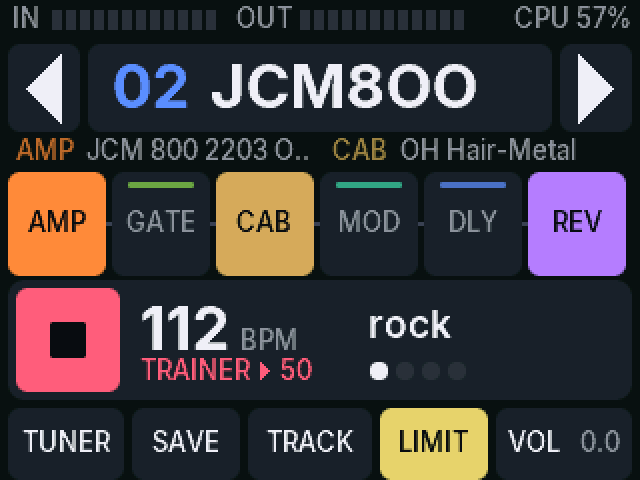 | 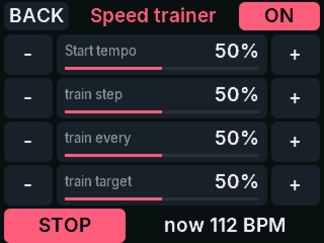 |

| Save, rename, delete | The new preset's name |
| --- | --- |
| 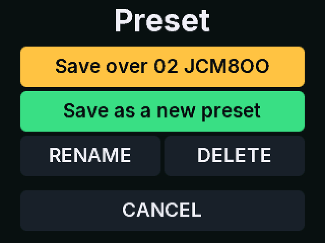 | 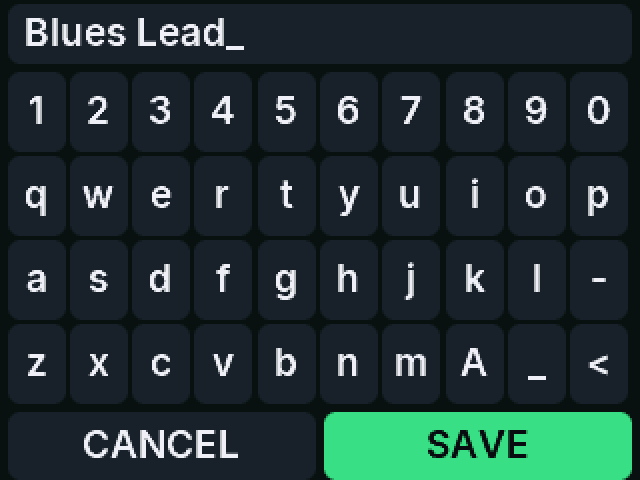 |

| Master volume | The delete question |
| --- | --- |
| 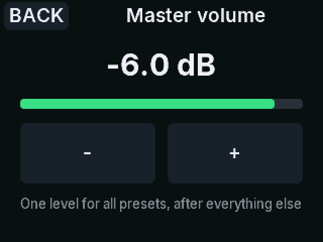 | 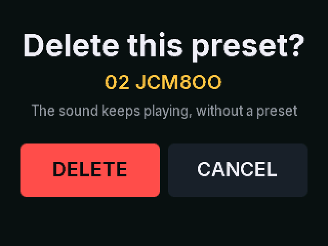 |
| The trainer's second page | The list of songs |
| 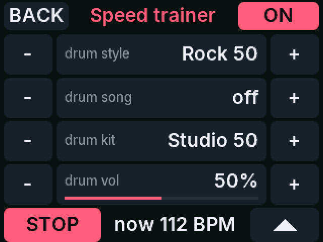 | 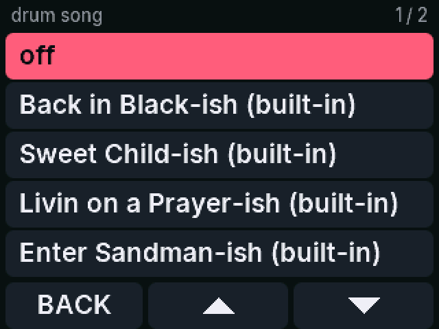 |

| The backing track, playing a loop at 80 % | The backing track while its tempo is being found |
| --- | --- |
| 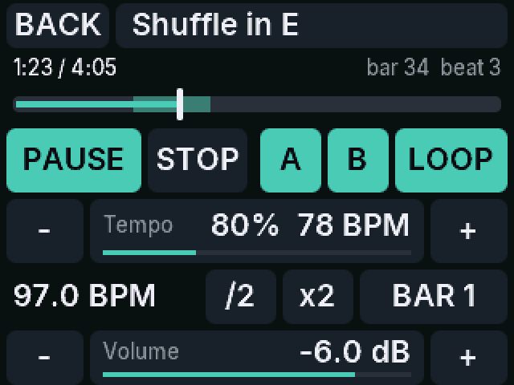 | 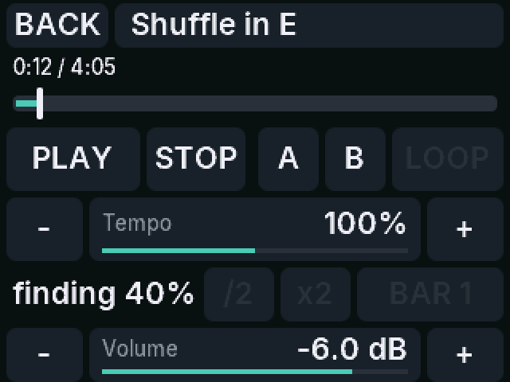 |
| The list of tracks: the top folder | Inside a folder |
| 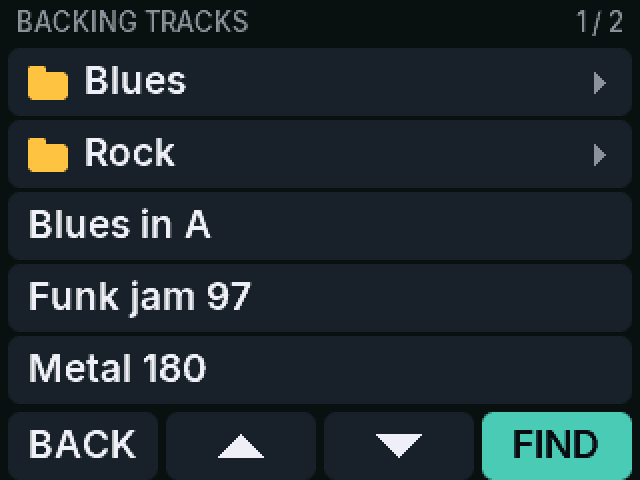 | 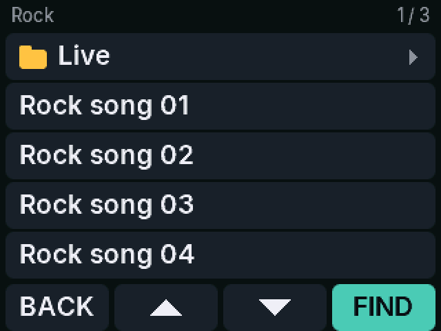 |
| FIND: the words to search for | What was found, in all folders |
| 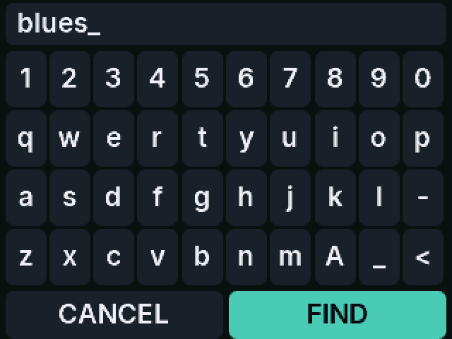 | 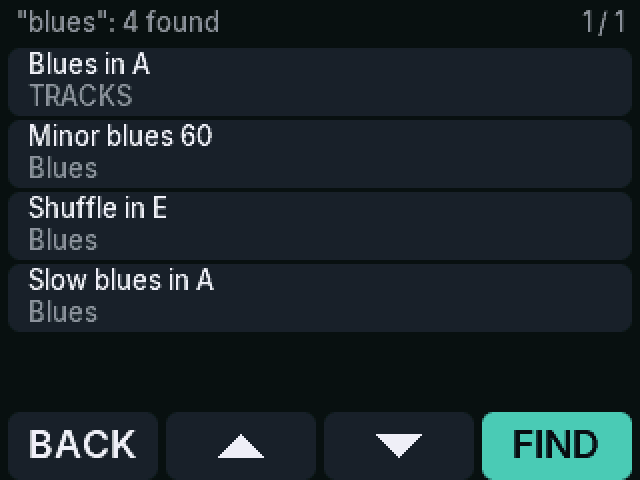 |
| Home while a track plays | |
| 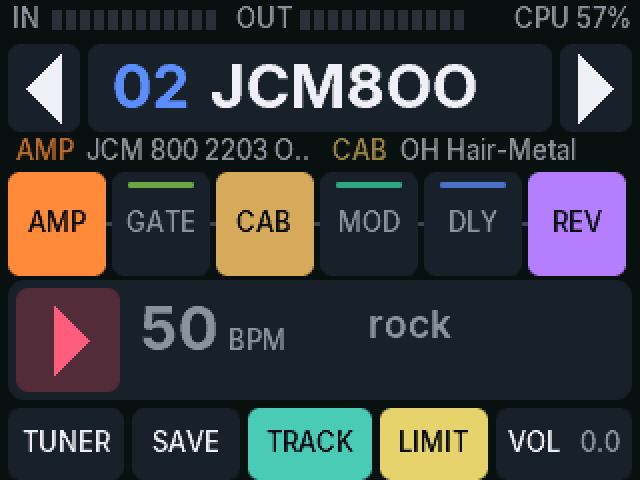 | |

(The pictures come from the host test's made-up unit, which labels settings by their keys and gives every number as a percentage; the unit shows the table's labels (Type, Mix, Time, Repeats) and real values, so the stopped tempo on home is the set one.)

- **Home** (laid out anew on 14 Nov 2026, asked for by the author: the first layout gave the preset's number half the screen, broke the chain into two rows and had the drums among the chain's tiles). From the top:
  - Input and output meters and the CPU load.
  - **The preset in one bar:** number and name side by side between previous and next (holding repeats). A tap on the bar opens the preset list (there is no PRESETS button any more). Edited: the number turns amber, an amber dot shows, and SAVE is lit. A long name is shown in a smaller font (three sizes) before it is cut.
  - **What is loaded:** the amp's model and the cab's IR by name (not touched: the line is too low to hit).
  - **The chain in one lane:** AMP, GATE, CAB, MOD, DLY, REV (six since the doubler was removed on 14 Nov 2026; 49 px wide each), in the order the guitar passes them, in the app's colours, lit while the block is on, with a line running behind them. A tile shows the block's name and nothing else (its values were on the tiles for an hour on 14 Nov 2026; the author found the screen crowded). A tap switches the block, **holding it for half a second opens its settings**.
  - **The drums in a panel of their own:** play / stop (holding opens the DRUMS + BASS settings); the tempo, always shown (as it plays, or the set one while stopped), with the trainer's target under it while the trainer is on; the song's or style's name, and while the drums play a dot for each beat of the bar (the sounding one lit, the first in white). No kit name and no bar number: the author asked for less on the screen. A tap on the tempo opens the speed trainer, a tap on what plays opens the trainer's second page (style, song, kit, volume).
  - **Bottom line:** TUNER, SAVE, TRACK (15 Nov 2026: opens the backing track's screen; lit while a track plays), then the end of the signal's way: LIMIT and VOL. With five in the line their names are in the small font, like the chain's tiles; before, the four were in the medium one. The limiter is not among the chain's tiles because it is one setting for all presets and acts after the master volume on guitar and drums alike; it is switched and opened like a tile, and a red bar grows on it while it turns the level down (2 dB a step, up to 12 dB). VOL shows the master volume's value.
- **Backing track** (15 Nov 2026; what it is: [SIGNAL_CHAIN.md](SIGNAL_CHAIN.md), "Backing track"): TRACK on the home screen. From the top:
  - **The track's name:** a tap opens the list of tracks; a tap on a track opens it and comes back. Without a track the other controls are dim.
  - **The list of tracks** (folders and search added 15 Nov 2026): one folder at a time, five rows to a page, the folder's name at the top. Its folders come first (a folder mark in front, an arrow behind; a tap goes in), then its tracks by name, the open one lit. The list opens in the open track's folder, on its page. BACK goes up one folder (to the page that folder is on), and from the top back to the track's screen. Holding a page button keeps paging (after 0.6 s, every 0.3 s; the model and IR lists do the same now). While the card is still being read after power-on the title says "reading N" and folders fill as they are read.
  - **FIND** on the list opens the keyboard (lower case; the case does not count). FIND there lists the tracks from all folders that have every typed word in their name or in the name of a folder they are in ("iron" finds "Iron man" and everything in "Iron Maiden"); `_` in a file's name counts as a space. A hit shows its name and, under it, the folder it is in; a tap opens it. At most 256 hits are shown ("256+ found"). BACK returns to the folder; the list then shows the folder of the track that was opened.
  - **Where it is:** time and length, bar and beat once the track's tempo is known, and a bar for the whole track with the loop shown lighter. A tap on the bar goes there; a finger slid along it moves the place from where it was (the bar follows the finger, the track follows five times a second and when the finger lifts).
  - **PLAY / PAUSE** (one button, lit while it plays), **STOP** (back to the start, or to the loop's start).
  - **A, B, LOOP:** A marks the loop's start where the track is now, B its end; with both the loop holds and all three are lit. LOOP ends it. The marks go to the nearest beat, or bar line once bar 1 is set.
  - **Tempo:** minus and plus in steps of 1 % (holding repeats, then 5 % at a time), 50 % to 150 %, with what that is in BPM once the track's own tempo is known.
  - **The track's own tempo:** "finding 40 %" while the scan runs (it runs while the track is not playing), then the BPM, with a question mark in amber if the scan was unsure, or "no beat". /2 and x2 correct a tempo found at double or half; BAR 1 says that bar 1 starts where the track is now.
  - **Volume:** the track's level (`track vol`), minus and plus in half-dB steps.
  - Not on the screen: a tempo typed as a number, beats in a bar, loops by bar numbers, snapping off, a new scan (all in the shell: [CONTROL.md](CONTROL.md)).
- **Save** (14 Nov 2026): over the recalled preset (offered while it is edited), or as a new preset. A new preset's name is typed on a keyboard: digits, letters, hyphen, space, delete; a word's first letter comes in upper case and the rest in lower, and the Aa key changes that for what follows. Up to 24 characters; with no name the unit calls it "Preset NN". The new preset takes the lowest free number and becomes the recalled one. If the unit cannot save (no card, or all 99 numbers taken) the screen stays and says so.
- **Rename and delete** (14 Nov 2026): in the same menu, for the recalled preset. Rename opens the keyboard with the name it has; the number stays, and unsaved edits are not touched. An empty name or one another preset has is refused and the screen says so. Delete asks first; after it the sound keeps playing with no preset recalled (`renamePreset`, `deletePreset` in `src/PresetLibrary.h`).
- **Master volume** (14 Nov 2026): Vol on the home screen. Minus and plus in half-dB steps (holding repeats, then 2.5 dB at a time), from 0 dB down to silent. One level for all presets, not part of a preset. The value and its bar can also be dragged (see below).
- **A block's settings** (added 14 Nov 2026): the settings `protocol/blocks.json` gives the block, four to a page, each with minus and plus. A tap is one step of the setting's own size (the table's `step`); holding repeats ten times a second and after the tenth goes five steps at a time. A toggle also flips by a tap on its name. Settings that do not apply to the chosen type or mode are left out, as in the app (the `only` rules). ON / OFF at the top is the block's switch. Labels are the table's short ones, or the full name where two in a block share one (the drums' and the bass's Volume).
- **A list for a named choice** (14 Nov 2026): a setting chosen by name with more than two choices (the drums' style, song and crash, a type, a mode, the bass's key) opens a list of its names by a tap on it, five to a page, opened on the page of the one that is set. A tap on a row chooses at once and the list stays; BACK returns to the screen it was opened from. Minus and plus still step. Choosing a song sets the tempo to the song's, as from the shell. Until this was added, minus and plus on the drum song did nothing on the screen: the screen changed saved settings through `setParamQuiet()`, which leaves the song alone; it now goes through `setParam()`.
- **Dragging a value** (14 Nov 2026): a setting with a bar (a block's settings, the trainer's rows, the master volume) follows a finger slid sideways along it. The drag begins after 10 px of sideways movement and the value then moves from where it was, the bar's width being the whole range (192 px for a setting, 280 px for the master), on the setting's own steps; the finger may leave the row once the drag has begun. A tap on a value changes nothing, so a stray touch cannot move a setting. Choices and toggles are not dragged. Lists are not dragged or swiped: they keep their page buttons.
- The author tried dragging and the keyboard with a finger on the glass on 14 Nov 2026: both work fine.
- **Preset list:** five to a page. A tap plays a preset without committing to it; OK keeps it, Back returns to the sound from before, edits included (`previewPreset`, `keepPreview`, `cancelPreview` in `src/PresetLibrary.h`).
- **Unsaved changes:** leaving an edited preset (previous, next, or OK in the list) asks first: Save, Discard or Cancel.
- **Tuner:** note, a needle (green within 3 cents) and the frequency; the guitar is muted while it is open, as with the shell's and the app's tuner.
- A change made elsewhere (the app, MIDI, the shell) shows by itself: every pass the screen compares what it would show now with what is on the glass.

- **Speed trainer** (added 14 Nov 2026, asked for by the author to be as easy to reach as possible): the tempo in the home screen's drums panel opens it with one tap. The trainer's switch at the top, the tempo it starts from, step, every and target with minus and plus, the drums' PLAY / STOP, and the tempo as it plays. The arrow at the bottom right changes to a second page with what the drums play: style, song, kit and drum volume (the switch and PLAY / STOP stay); the trainer always opens on its first page. The home screen shows the tempo reached while the drums play, and the trainer's target while it is switched on. With a drum song chosen the screen says so (the trainer is for styles). The values are the drum block's own settings, so they are also in the DRUMS tile's settings, the app and the shell.
- **Model and IR** (added 14 Nov 2026): the Amp's and the Cab's settings begin with the file they play. The arrows load the previous or next file of the unit's list (round the ends); a tap on the name opens the list, five to a page, where a tap loads a file at once and the one that plays is lit. Names are shown without folder and extension, with spaces for underscores; long ones in the small font. A loaded file is an edit of the preset like any other (Save, or the question on leaving).

Not there: the blocks' notes.

## How it is built

| Part | Where | What |
| --- | --- | --- |
| Screens, touch handling, drawing | `lib/ui` (portable, namespace `ui_tft`) | `Ui` (the screens), `Canvas` (rectangles, rounded boxes, smoothed text into a strip of pixels), `Font`, `UiModel` (what the screens need from the unit) |
| Fonts | `lib/ui/src/ui/Fonts.cpp`, made by `tools/make_font.py` | Inter 4.1 (SIL Open Font License) at 13, 19, 30 and 76 px, 2 bits a pixel, 29 KB |
| Blocks | `lib/ui/src/ui/BlocksGen.h`, made by `tools/make_blocks_header.py` | Names, colours and switches from `protocol/blocks.json`, the file the app reads (`tft` there is a shorter name for the home screen's narrow tiles: DLY, REV); a host test fails if the header is out of date |
| The unit's side | `src/Screen.cpp` | Display and touch drivers (`ILI9341_t3`, `XPT2046_Touchscreen` from the Teensy framework), the `UiModel` over `Params`, `PresetLibrary`, `Tuner` and the chain, calibration, the `tft` commands |
| Meters for several readers | `src/Meters.cpp` | The chain's peak readings and the limiter's lowest gain clear on reading; here the screen, the app and the shell each get every one |

- **A part paints inside its own rectangle only.** What it paints outside is cut off when that part alone is repainted. Found on 14 Nov 2026 on the glass by the author: the drums' style name on the home screen was cut after the drums were stopped. The host test `test_random_use_keeps_the_glass_true` now uses every screen at random (taps, holds, drags, the unit changing by itself; 6000 steps) and after each step compares the glass with a whole repaint; it fails on that fault when it is put back.
- **No frame buffer.** A screen is one layout function that names each part with its rectangle. It runs three ways: to note a number for what each part shows now, to paint the parts that fall into a strip, and to find the part under a finger. A part is repainted when its number changes; a meter is twelve parts, so a level change repaints a few 5 x 10 rectangles.
- **Strips.** What changed is composed into a strip of at most 320 x 16 pixels (10 KB, RAM2) and sent as one rectangle, one strip for each pass of `loop()`, so the shell, MIDI and the app are served in between.
- **Touch.** Read every 10 ms. A tap counts on release, on the control where it began; sliding off cancels; contact lost for under 40 ms is bounce; a held control counts as 8 px larger. While a value is dragged each reading is used one reading late and the last one before the finger lifts is dropped, because a resistive panel's point jumps as the pressure goes.
- **No display attached:** found at boot (the display does not answer a status read), and then nothing is drawn or read. `tft on` and `tft off` force it either way; the choice and the touch calibration are kept in their own small record in the EEPROM (address 3900), apart from the settings record.
- **Calibration:** two crosses, started by itself the first time a display is found, later by `tft cal`.
- All of it is linked into flash (`tools/imxrt1062_t41_cold.ld`): RAM1 code is unchanged.

## What it costs (measured 14 Nov 2026, no display attached)

| | Screen off | Screens running | Repainting all the time (`tft bench full`) |
| --- | --- | --- | --- |
| Typical preset, audio worst case | 57.2 % | 57.1 % | 57.3 % |
| Everything on, audio worst case in 14 s | 78.9 and 81.8 % | 78.7 and 82.3 % | 77.9 and 79.5 % |
| Overruns | 0 | 0 | 0 |

- The audio does not notice the screen: the differences are inside the spread between two runs. It cannot be interrupted by it either (the audio runs in an interrupt, the screen in `loop()`).
- Speed is what the audio leaves of the SPI bus: a 320 x 16 strip takes 9.7 ms with everything on, so a whole screen about 0.15 s (15 strips); a meter change is under 1 ms.
- Noise at the guitar input with the display wired (input peak with nothing played, three 8 s readings each; what was plugged into the input was not recorded): screen showing home −83.3 to −84.0 dBFS; repainting all the time (`tft bench full`) −81.8 to −82.4 dBFS. So a constantly busy bus adds about 1.5 dB to a floor near −83 dBFS; in use the bus is idle except for meter segments and screen changes.
- Memory: flash 62 KB (code, fonts); RAM1 data 3 KB; RAM2 10 KB; stack unchanged (16.9 KB deepest). The new home screen (14 Nov 2026) has more parts than the first, so the room for parts went from 64 to 96: 0.8 KB more RAM1 data ("free for local variables" 87.6 to 86.8 KB); RAM1 code is unchanged, the flash grew by a few KB (not measured apart).

## Looking at the screens without the unit

```
pio test -e native -f test_ui && python3 tools/ui_render.py
```

writes each screen as a PNG to `.pio/ui/`, drawn by the code the unit runs, with a made-up unit behind it. The pictures above are made this way (`python3 tools/ui_render.py docs/img/screen`).

## What is not checked

- The author's verdict on the picture and the touch: colours, sharpness, anything to change in the layout.
- **The new home screen on the glass** (14 Nov 2026): flashed the same day; the unit shows home, 0 overruns, and injected taps (`tft tap`) on the tempo, on what plays and on the preset's bar open the trainer and the preset list and come back. Not tapped on the unit: the tiles, PLAY and LIMIT (they change the sound). Nobody has looked at it yet. The author then asked for less on it (no values on the tiles, no kit name, no bar number): that version was flashed the same day and runs (home shown, 0 overruns). On it the author saw the style's name move and lose its lower edge after the drums were started and stopped: fixed (the tempo and the name now keep their places whatever plays), host-tested and flashed: on the unit a tap on PLAY started the drums and a second one stopped them (master at -40 dB for the test, put back to 0 dB), 0 overruns. The shell cannot show what the glass shows, so the name's place after a stop is for the author to confirm. Open there: whether the chain's 42 px wide tiles are comfortable to hit (the first layout's were 60 x 40), the beat dots against the real drums, the limiter's bar.
- **The backing track's screen, its list with folders and FIND, and the five-button bottom line** (15 Nov 2026): flashed and run by injected taps on the unit with the author's card (59 tracks in 9 folders): into a folder, a page down, a tap opens the track; FIND, "iron" typed, the first hit opened; BACK up to the track's screen. Not seen on the glass by anyone and not touched by a finger. Host tests cover it (every control, folders, held page buttons, the search with and without hits, the slide along the bar, repainting only what changed, random use against a whole repaint).
- **Noise by ear** with a high-gain preset, and a reading with the guitar plugged in and its volume down (the measurement above did not record what was at the input). Whether the backlight on its own adds noise was not separated from the bus.
- The tuner screen, the unsaved-changes question, the blocks' settings screens, the file lists, the master volume's buttons, renaming and deleting a preset, the trainer's second page and the lists of choices on the glass (run by injected touches only: `tft tap <x> <y> <ms>`).
- Possible later: sending strips by DMA, which would keep the bus busy while the audio runs (a whole screen in about 45 ms instead of 150).
