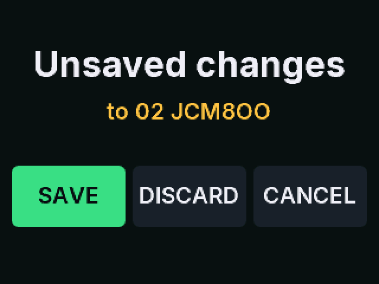

# The touch screen

The unit's own screen as it is built: a 2.8-inch ILI9341 display (320 x 240 in landscape, SPI) with an XPT2046 resistive touch panel. Wiring: [HARDWARE.md](HARDWARE.md#touch-screen). Shell commands: [CONTROL.md](CONTROL.md). Last checked against the code: 14 Nov 2026.

**State on 14 Nov 2026: the display is wired and running.** The author wired it and reported it works; the unit finds it at boot, touch was calibrated on the glass, and presets were changed from it. The screens are also checked by host tests and as pictures, and on the unit by taps sent over the shell (`tft tap`). The first noise reading is under "What it costs"; what the author has not yet said is under "What is not checked".

## What it shows (first version: playing)

| Home | Preset list |
| --- | --- |
|  |  |
| Tuner | Unsaved changes |
|  |  |

- **Home:** input and output meters and the CPU load; the preset's number and name with previous and next (holding repeats); the chain as tiles in the app's colours, lit while the block is on, a tap switches it; Tuner and Presets.
- **Preset list:** five to a page. A tap plays a preset without committing to it; OK keeps it, Back returns to the sound from before, edits included (`previewPreset`, `keepPreview`, `cancelPreview` in `src/PresetLibrary.h`).
- **Unsaved changes:** leaving an edited preset (previous, next, or OK in the list) asks first: Save, Discard or Cancel.
- **Tuner:** note, a needle (green within 3 cents) and the frequency; the guitar is muted while it is open, as with the shell's and the app's tuner.
- A change made elsewhere (the app, MIDI, the shell) shows by itself: every pass the screen compares what it would show now with what is on the glass.

Not in this version: editing a block's settings, choosing a model or an IR, saving as a new preset, the drums' settings.

## How it is built

| Part | Where | What |
| --- | --- | --- |
| Screens, touch handling, drawing | `lib/ui` (portable, namespace `ui_tft`) | `Ui` (the screens), `Canvas` (rectangles, rounded boxes, smoothed text into a strip of pixels), `Font`, `UiModel` (what the screens need from the unit) |
| Fonts | `lib/ui/src/ui/Fonts.cpp`, made by `tools/make_font.py` | Inter 4.1 (SIL Open Font License) at 13, 19, 30 and 76 px, 2 bits a pixel, 29 KB |
| Blocks | `lib/ui/src/ui/BlocksGen.h`, made by `tools/make_blocks_header.py` | Names, colours and switches from `protocol/blocks.json`, the file the app reads; a host test fails if the header is out of date |
| The unit's side | `src/Screen.cpp` | Display and touch drivers (`ILI9341_t3`, `XPT2046_Touchscreen` from the Teensy framework), the `UiModel` over `Params`, `PresetLibrary`, `Tuner` and the chain, calibration, the `tft` commands |
| Meters for several readers | `src/Meters.cpp` | The chain's peak readings clear on reading; here the screen, the app and the shell each get every peak |

- **No frame buffer.** A screen is one layout function that names each part with its rectangle. It runs three ways: to note a number for what each part shows now, to paint the parts that fall into a strip, and to find the part under a finger. A part is repainted when its number changes; a meter is twelve parts, so a level change repaints a few 5 x 10 rectangles.
- **Strips.** What changed is composed into a strip of at most 320 x 16 pixels (10 KB, RAM2) and sent as one rectangle, one strip for each pass of `loop()`, so the shell, MIDI and the app are served in between.
- **Touch.** Read every 10 ms. A tap counts on release, on the control where it began; sliding off cancels; contact lost for under 40 ms is bounce; a held control counts as 8 px larger.
- **No display attached:** found at boot (the display does not answer a status read), and then nothing is drawn or read. `tft on` and `tft off` force it either way; the choice and the touch calibration are kept in their own small record in the EEPROM (address 3900), apart from the settings record.
- **Calibration:** two crosses, started by itself the first time a display is found, later by `tft cal`.
- All of it is linked into flash (`tools/imxrt1062_t41_cold.ld`): RAM1 code is unchanged.

## What it costs (measured 14 Nov 2026, no display attached)

| | Screen off | Screens running | Repainting all the time (`tft bench full`) |
| --- | --- | --- | --- |
| Typical preset, audio worst case | 57.2 % | 57.1 % | 57.3 % |
| Everything on, audio worst case in 14 s | 78.9 and 81.8 % | 78.7 and 82.3 % | 77.9 and 79.5 % |
| Overruns | 0 | 0 | 0 |

- The audio does not notice the screen: the differences are inside the spread between two runs. It cannot be interrupted by it either (the audio runs in an interrupt, the screen in `loop()`).
- Speed is what the audio leaves of the SPI bus: a 320 x 16 strip takes 9.7 ms with everything on, so a whole screen about 0.15 s (15 strips); a meter change is under 1 ms.
- Noise at the guitar input with the display wired (input peak with nothing played, three 8 s readings each; what was plugged into the input was not recorded): screen showing home −83.3 to −84.0 dBFS; repainting all the time (`tft bench full`) −81.8 to −82.4 dBFS. So a constantly busy bus adds about 1.5 dB to a floor near −83 dBFS; in use the bus is idle except for meter segments and screen changes.
- Memory: flash 62 KB (code, fonts); RAM1 data 3 KB; RAM2 10 KB; stack unchanged (16.9 KB deepest).

## Looking at the screens without the unit

```
pio test -e native -f test_ui && python3 tools/ui_render.py
```

writes each screen as a PNG to `.pio/ui/`, drawn by the code the unit runs, with a made-up unit behind it. The pictures above are made this way (`python3 tools/ui_render.py docs/img/screen`).

## What is not checked

- The author's verdict on the picture and the touch: colours, sharpness, whether the 40 px tiles are comfortable to hit, anything to change in the layout.
- **Noise by ear** with a high-gain preset, and a reading with the guitar plugged in and its volume down (the measurement above did not record what was at the input). Whether the backlight on its own adds noise was not separated from the bus.
- The tuner screen and the unsaved-changes question on the glass (run by injected taps only).
- Possible later: sending strips by DMA, which would keep the bus busy while the audio runs (a whole screen in about 45 ms instead of 150).
